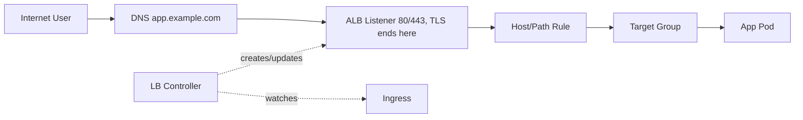

# DevOps Winter Arc: Day 40

**Topic:** AWS EKS, AWS Load Balancer Controller
**Theme:** Exposing Kubernetes applications safely

---

## What I Learned

- Kubernetes Service types: ClusterIP, NodePort, LoadBalancer
- ALB (Layer 7) vs NLB (Layer 4)
- Ingress vs Ingress controller
- How the AWS Load Balancer Controller reconciles Kubernetes with AWS
- Target groups, health checks, basic troubleshooting

---

## Task A: Request Flow




- DNS points to the ALB DNS name (CNAME or Route 53 alias)
- HTTPS/TLS is terminated at the ALB (ACM certificate)
- Controller watches Ingress and reconciles AWS resources

---

## Task B: Exposure Methods

| Type | Access | Use case |
|---|---|---|
| ClusterIP | Inside the cluster only | Service to service |
| NodePort | Node IP + port (30000-32767) | Testing, needs exposure controls |
| LoadBalancer | Cloud LB, one per Service | TCP/UDP, Layer 4 (NLB) |
| Ingress + Controller | ALB with host/path rules | HTTP/HTTPS, one ALB for many apps |

**ALB vs NLB**

| | ALB | NLB |
|---|---|---|
| Layer | 7 | 4 |
| Protocol | HTTP/HTTPS | TCP/UDP/TLS |
| Routing | Host, path | Port based |

---

## Task C: Cluster Inspection (Read-only)

Commands used:

```bash
kubectl get nodes -o wide
kubectl get svc -A
kubectl get ingress -A
kubectl get pods -A
kubectl describe svc external-dns -n external-dns
kubectl get endpoints external-dns -n external-dns
kubectl get endpointslices -n external-dns
kubectl get events -n external-dns --sort-by=.lastTimestamp
```

**Findings (sanitized)**

| Item | Result |
|---|---|
| Nodes | 2, Ready, region ap-south-1 |
| Services | All ClusterIP, no LoadBalancer or NodePort |
| Ingress | None found |
| AWS Load Balancer Controller | Not installed |
| external-dns | Running (manages DNS records, does not create ALBs) |

**Service inspected: external-dns**

| Item | Value |
|---|---|
| Namespace | external-dns |
| Type | ClusterIP |
| Port | 7979/TCP (http) |
| Selector | `app.kubernetes.io/instance=external-dns`, `app.kubernetes.io/name=external-dns` |
| Endpoint | one Pod IP on port 7979 |
| Events | None |

Note: `Endpoints` is deprecated in newer Kubernetes, use `EndpointSlice`.

No Ingress exists, so no AWS resources were created.

---

## Task D: Ingress Design (not applied)

```yaml
apiVersion: networking.k8s.io/v1
kind: Ingress
metadata:
  name: web-ingress
  namespace: demo
  annotations:
    alb.ingress.kubernetes.io/scheme: internet-facing
    alb.ingress.kubernetes.io/target-type: ip
    alb.ingress.kubernetes.io/listen-ports: '[{"HTTP":80},{"HTTPS":443}]'
    alb.ingress.kubernetes.io/certificate-arn: <ACM_CERT_ARN>
    alb.ingress.kubernetes.io/healthcheck-path: /
spec:
  ingressClassName: alb
  rules:
    - host: app.example.com
      http:
        paths:
          - path: /
            pathType: Prefix
            backend:
              service:
                name: web-service
                port:
                  number: 80
```

**Why the controller is required:** an Ingress is only a set of rules. Without a controller, no ALB is created.

**Considerations**

- **DNS:** app.example.com points to the ALB DNS name
- **TLS:** ACM certificate, terminated at the ALB
- **Subnets:** public subnets tagged `kubernetes.io/role/elb=1`
- **Security groups:** ALB allows 80/443, Pods/nodes allow traffic from the ALB
- **Health check:** path `/`, port 80, Pod readiness must pass
- **IAM:** dedicated role with scoped permissions (IRSA or EKS Pod Identity), no admin access

**Verify**

```bash
kubectl get ingress -n demo
kubectl describe ingress web-ingress -n demo
curl -H "Host: app.example.com" http://<ALB_DNS>
```

- AWS console: ALB is active, target group is healthy

---

## How the Controller Reconciles

1. Watches Ingress and Service resources
2. Compares desired state (Kubernetes) with actual state (AWS)
3. Creates or updates ALB, listeners, rules, target groups
4. Registers Pod IPs as targets

---

## Troubleshooting

| Problem | Check |
|---|---|
| No Ingress address | IngressClass, controller Pods/logs, events, IAM, subnet tags |
| ALB not created | Controller install, IAM permissions, subnet tags, security groups |
| Unhealthy targets | Target type, Service port, Pod readiness, health-check path/port |
| 404 | Host/path rules, listener rules, backend Service name/port |
| No connectivity | DNS, target health, security groups, NACLs, app readiness |

---

## Interview Quick Check

- **ALB vs NLB:** ALB is Layer 7 (HTTP/HTTPS, host/path routing). NLB is Layer 4 (TCP/UDP/TLS).
- **What does the controller do:** configures AWS load balancers from Kubernetes resources.
- **Ingress vs Ingress controller:** Ingress is the rules. The controller implements them.
- **Ingress without an ALB address:** controller missing, wrong IngressClass, IAM or subnet tag issue.
- **Target group and health check:** target group holds the destinations. Health checks decide which receive traffic.

---

## Completion Checklist

- [x] Compared ClusterIP, NodePort, LoadBalancer, Ingress
- [x] Explained ALB vs NLB and the controller role
- [x] Designed Ingress rule and request flow
- [x] Know the main troubleshooting checks
- [x] Avoided creating paid resources without approval

---

## Cost and Safety Note

ALB/NLB, public IPv4, EKS control plane and EC2 nodes are billable. The controller was not installed and no AWS Ingress was created.
